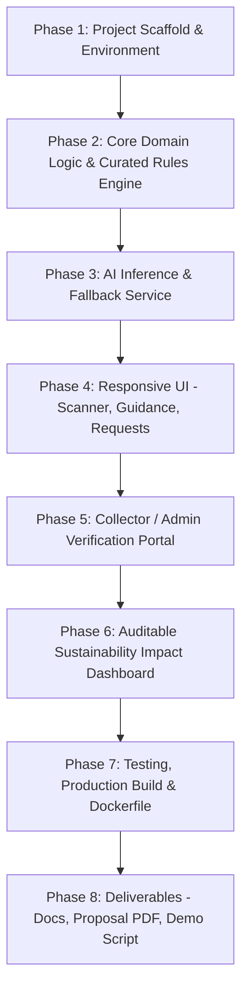

# IMPLEMENTATION_PLAN.md — EcoLoop AI (AI Builder Cup Hackathon)

## Executive Summary
**EcoLoop AI** is an AI-powered waste recovery and circular economy platform built for the **AI Builder Cup Sustainability Hackathon**. The core differentiator is **verified recovery, not just waste identification**—ensuring waste is tracked from household scanning to verified handover by authorized collectors (such as Haritha Karma Sena / Clean Kerala Company in Kerala, India) before claiming environmental impact.

---

## 1. System Architecture & Tech Stack

### A. Frontend & Application Framework
- **Framework**: Next.js 14+ (App Router), React 18, TypeScript.
- **Styling**: Tailwind CSS with custom sustainability color palette (Emerald, Forest, Slate, Amber), glassmorphic accents, responsive mobile-first layouts.
- **Icons**: Lucide React for consistent, crisp SVG iconography.
- **Languages**: English and Malayalam (മലയാളം) toggleable across the scanning and guidance UI.

### B. AI & Guidance Engine
- **Vision Model**: Google Gemini (`gemini-2.5-flash` / `gemini-1.5-flash`) via `@google/genai` SDK for structured multimodal item classification.
- **Validation Layer**: Zod schema validation ensuring strict types for material category, subcategory, contamination level, certainty score, and recommended handling.
- **Curated Guidance Engine (Deterministic)**: Rule-based engine grounded in Kerala municipal policies (Suchitwa Mission, Haritha Karma Sena door-to-door dry waste calendar, Clean Kerala Company, composting standards).
- **Graceful Fallback**: High-fidelity offline simulation engine activating automatically if `GEMINI_API_KEY` is not supplied, allowing zero-friction judge evaluation and testing.

### C. State, Storage & Evidence Verification
- **Data Layer**: Modular storage repository supporting **Cloud Firestore** and an **auditable In-Memory / Local Storage database** with pre-seeded demo records for seamless zero-setup demo runs.
- **Strict Status Transitions**: `pending` → `scheduled` → `collected` → `accepted` (or `rejected` / `cancelled`).
- **Chain of Custody & Evidence**: Records actor ID, timestamp, collector ID, photo receipt reference, verified weight (kg), and non-recyclable contamination deductions.

### D. Sustainability & Impact Engine
- **Calculations**: Derived from verified accepted weights using documented emission factor models (Central Pollution Control Board / EPA WARM factors):
  - Diverted Landfill Mass (kg)
  - Estimated Avoided GHG Emissions (kg CO₂e)
  - Water & Energy conservation equivalents
- **Auditable Ledger**: Every dashboard metric traces directly back to validated collection event records.

---

## 2. Implementation Phases

### Phase 1: Foundation & Project Setup
- [x] Audit workspace, CLI tools, and runtime dependencies.
- [x] Initialize Next.js 14 project with TypeScript, Tailwind CSS, and Lucide React.
- [x] Set up environment configuration (`.env.example` and validation).

### Phase 2: Domain Engine & Kerala Waste Guidance
- [x] Build deterministic Knowledge Base of Kerala waste rules (Suchitwa Mission, Haritha Karma Sena).
- [x] Implement bilingual dictionary (English & Malayalam) for waste categories and instructions.
- [x] Create Zod schemas for `WasteItem`, `ClassificationResult`, `CollectionRequest`, `VerificationEvidence`.

### Phase 3: Gemini AI Service & Offline Mock
- [x] Implement `@google/genai` connector with structured JSON prompt and image processing.
- [x] Implement calibrated uncertainty assessment (flagging multilayer plastics, hazardous e-waste, food-contaminated items).
- [x] Implement simulation mode for automated testing and offline demos.

### Phase 4: User Journey UI (Scanner & Guidance)
- [x] Build modern drag-and-drop / camera upload component with instant image preview.
- [x] Build sample quick-selector (milk packets, plastic bottles, coconut shells, cardboard, batteries, e-waste).
- [x] Build classification result card with certainty breakdown, preparation checklist, and local collection day notice.

### Phase 5: Collection & Verification Lifecycle
- [x] Build Handover/Pickup request creation form with estimated weight.
- [x] Build Admin/Collector Portal to simulate or record physical collection.
- [x] Enforce verification requirement (collector ID, actual weighed quantity, handover receipt).

### Phase 6: Auditable Sustainability Dashboard
- [x] Aggregated metrics: Items scanned, Handover requests, Verified recovered kg, Landfill diversion rate.
- [x] Transparent GHG reduction formula card with methodology citations.
- [x] Activity log showing real-time auditable handover history.

### Phase 7: Verification & Testing
- [x] Unit tests for classification parsing, status transitions, and impact metrics.
- [x] End-to-end user workflow test in browser.
- [x] Production build (`npm run build`) verification.
- [x] Dockerfile creation for Google Cloud Run deployment.

### Phase 8: Submission Deliverables
- [x] Comprehensive `README.md`.
- [x] Detailed `docs/architecture.md`.
- [x] Hackathon Proposal `docs/hackathon-proposal.md`.
- [x] Proposal PDF generated via headless Chrome (`docs/EcoLoop_AI_Hackathon_Proposal.pdf`).
- [x] Timed 3-minute video demo script (`docs/demo-script.md`).
- [x] Demo runbook & judge checklist (`docs/demo-checklist.md`).

---

## 3. Key Decisions & Assumptions

| Decision | Rationale |
|---|---|
| **Next.js Fullstack Monolith** | Combines React UI, API routes, and backend business logic in a single deployable container for Google Cloud Run. |
| **Bilingual English + Malayalam** | Localized for Kerala context, directly addressing local civic bodies (Suchitwa Mission / Haritha Karma Sena). |
| **Dual-Mode Data Store** | Uses Firestore when credentials are provided; falls back gracefully to in-memory/file storage for local test runs. |
| **Dual-Mode AI Engine** | Direct Gemini API (`gemini-2.5-flash`) with structured schema output; robust fallback mock when offline. |
| **Audited Impact vs Speculative Claims** | Metrics are only incremented when an authorized collector verifies the weight. |

---

## 4. Risks & Mitigations

| Risk | Mitigation |
|---|---|
| **No Google Cloud credentials in local environment** | Containerize application with Dockerfile, provide automated build validation, and document exact Cloud Run deploy command (`gcloud run deploy`). |
| **Gemini API rate limiting or quota exhaustion** | Implement structured caching and the local fallback simulator so evaluation never crashes. |
| **Multimodal classification ambiguity** | Gemini prompt strictly queries physical indicators (e.g. foil lining, resin codes) and flags uncertain items for human inspection. |
